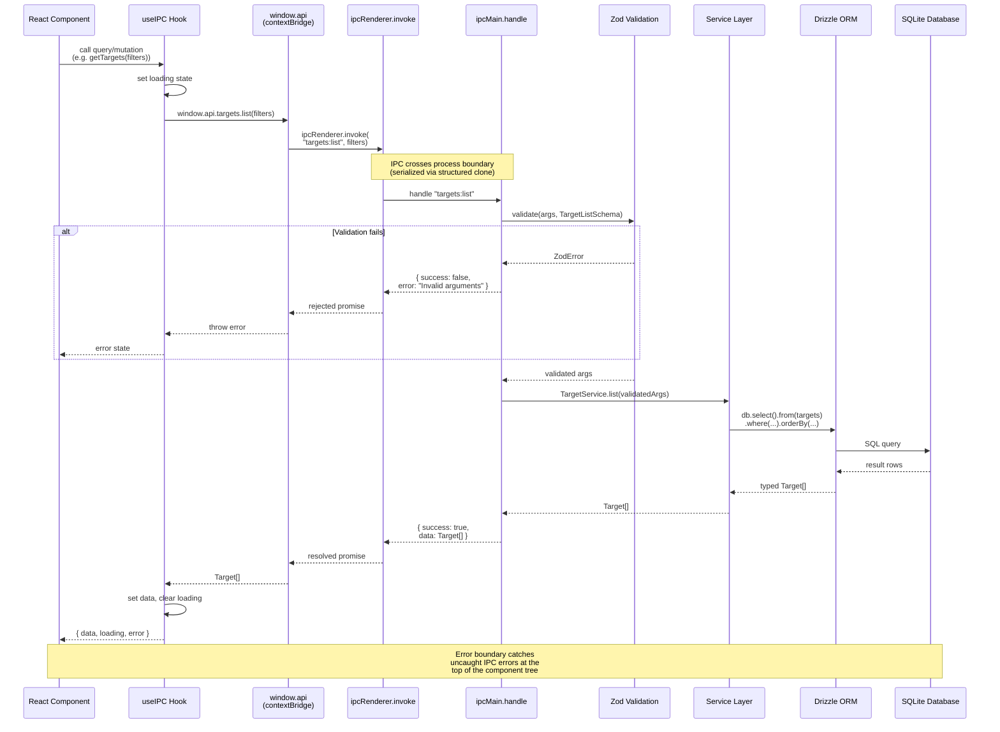

# IPC Communication Flow

The handlers live on a `ChannelRouter` (`src/main/transport/router.ts`, spec 035) that holds no Electron types; `src/main/electron/ipc-host.ts` hosts its channels with `ipcMain.handle`, and pickers, saving exports and opening folders go through the `Desktop` port (`src/main/transport/desktop.ts`), answered in the desktop app by `src/main/electron/electron-desktop.ts`. `npm run serve` (spec 035, slice 2) serves the same router over HTTP: `src/main/http/http-host.ts` answers `POST /api/invoke/<channel>` with `{ value }` or `{ error }`, and when no preload is present `src/renderer/bridge.ts` gives the page an `api.invoke` that posts there with the token the server wrote into the page.

All communication between the React renderer and the Node.js main process uses Electron's IPC (Inter-Process Communication) mechanism. The renderer never has direct access to Node.js APIs or the database. Instead, React components call typed wrapper functions exposed on `window.api` by the preload script's `contextBridge`. These wrappers invoke `ipcRenderer.invoke()`, which sends an asynchronous message to the main process. On the main-process side, `ipcMain.handle()` receives the call, validates the arguments against a Zod schema, delegates to the appropriate service method, and returns the result (or a structured error) back through the same channel.

