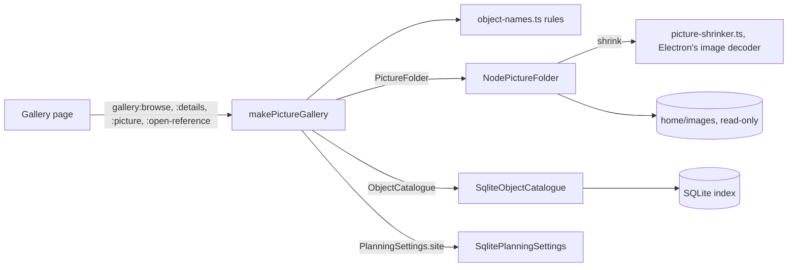

# The gallery

Every finished picture you have exported, in one grid, each one captioned with the object it shows
and leading back to what you have of that object. Requirements: [spec 031](../../specs/031-gallery/requirements.md).
Looking closely at one target's masters (histograms, palettes, compare) is the inspector's job,
described in [Using the cockpit](cockpit.md#inspecting-an-image).

## Using it

**Gallery → Pictures** shows every PNG and JPEG in the `images` folder of your home folder, and in
the folders inside it, as a grid of thumbnails, newest first. Search by file or object name, or
sort by file name or by object. Hidden folders and links are left out (an `images` folder that is
itself a link is not shown), and nothing in the folder is ever moved or renamed.

Each picture is captioned with the object it shows, read from its name:

- Catalogue designations in any form: `M31.png`, `m_031.png`, `Messier 31.jpg`, `NGC7000_HOO.png`,
  `IC 434.png`, `Sh2-155.png`, `C14.png` (Caldwell). Dates, exposures and gains such as
  `20241001` or `10.0s` are never read as objects, nor is a number past a catalogue's end.
- Common names and aliases from the catalogue, as whole words: `Andromeda Galaxy.png`,
  `AndromedaGalaxy.png`, `Bodes Galaxy.png`.
- When the file's name names nothing (`final.png`), the folder it is in: `M42/final.png`.

Pick a picture to see it large, with the arrow keys moving through the grid. The side panel says,
for each object the name names:

- **What it is**: a sentence such as "A galaxy in Andromeda, magnitude 3.4, 3°, about 6 full moons
  across.", then its type, constellation, magnitude, size, position and other names.
- **When to image it**: the month it is highest at midnight, how high it climbs from your site
  (or that it never rises there; without a site, a link to set one), and whether a dual-band or
  narrowband filter suits it.
- **Your data**: light frames, integration, nights and the last of them, masters and its stage.
- **Explore**: its page (Overview, Files with compare, Stack and process, Notes and nights), its
  mosaic plan in the Sky planner, the collections it is in, its folder, and its pages on
  Wikipedia and SIMBAD, opened in your browser.

A picture named for an object the app's catalogues do not hold says so; add it as a target and the
gallery picks it up next time. Thumbnails are made 400 pixels wide and the large view 2048, by the
system's own thumbnailer on Windows, so a folder of large exports stays quick. A picture saved
after the gallery was opened shows once you open the gallery again. The gallery only shows; the
counts and cover pictures on each target come from **Rescan** on the Library page.
## How it works

The gallery is a use case in the core, `makePictureGallery`
(`packages/application/src/use-cases/picture-gallery.ts`), over three ports. Nothing it does
writes to the images folder.

1. **Listing.** `NodePictureFolder` walks `<home>/images` and the folders inside it for PNG and
   JPEG files, leaving out hidden folders and links, and returns each file's folders, size and
   date. It never writes, renames or moves a file.
2. **Naming.** The catalogue's objects become one lookup (`objectNameIndex`): every designation
   and every common name or alias of at least four letters, the first object to claim a name
   keeping it. `readImageName` reads the file's stem for designations in any spelling
   (`designationsIn`: `M31`, `m_031`, `Messier 31`, `Sh2-155`) and for whole-word names, then
   falls back to the folders it sits in, nearest first. A number past a catalogue's end (M 200,
   C 500) is a date, an exposure or a gain, never an object.
3. **The side panel.** `details` asks the `ObjectCatalogue` for each named object's facts (type,
   size, designations, collections, frames, nights, masters) and adds the rules the planner uses:
   `midnightMonth` for the month it is highest at midnight, `highestAltitudeDeg` from your site,
   and `suitsNarrowband` from its type. The sentence at the top is `describeObject`.
4. **Pictures.** Thumbnails (400 pixels) and the large view (2,048 pixels) are made by
   `src/main/electron/picture-shrinker.ts` with Electron's image decoder, which on Windows and macOS uses
   the system's own thumbnailer and cache. Shrunk pictures are kept in memory (64 MB, least
   recently used first), so scrolling back does not decode them again. Where no system thumbnailer
   is available, a picture over 50 MB is not decoded; the viewer says so and offers its folder.
5. **Links out.** SIMBAD and Wikipedia addresses are built by `referenceUrl` and opened in your
   browser by the main process; the page cannot open an arbitrary address.

The name rules are tested by example (`packages/domain/test/object-names.test.ts`), by property
tests over generated names (`packages/domain/test/properties/object-names.property.test.ts`, which
found the "Sharpless2_-6" bug before it shipped) and by mutation testing. Both ports have contract
suites (`packages/testkit/src/contracts/picture-gallery.contract.ts`) run on the testkit's fakes
and on the real adapters.
