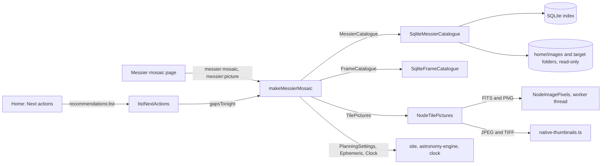

# The Messier mosaic

All 110 Messier objects on one page, each tile showing your own image of it, with what is still
missing and when each gap can be shot from your site. Requirements: [spec 032](../../specs/032-messier-mosaic/requirements.md).

## Opening it

- **Messier mosaic** under Collections in the sidebar.
- **View the Messier mosaic** on Home's "Where your targets are" card, and on Posters.
- A Messier gap in Home's **Shoot tonight** list opens the mosaic on that object's tile.

## What a tile shows

Tiles run M 1 to M 110, eleven to a row. The dot in the corner says how far the object has come:

| Dot | Means |
|---|---|
| Green | Imaged: a finished image is in its images folder now (one deleted since the last scan no longer counts) |
| Blue | Stacked, not finished: a master or processed image, but no finished one |
| Amber | Captured, not stacked: light subs only |
| Grey | Not captured yet |

The picture is your newest finished JPEG or PNG; else a finished TIFF, then a finished FITS, then
the newest colour master, then any master. A finished image keeps its own colours. A master is
auto-stretched, as the image inspector stretches it. If a picture cannot be drawn (a damaged file,
say), the tile tries the next one. When none draws, the tile says why in its details.

Finished images are found where the image scan put them: the object's own folder under
`<home>/images` and the folders directly inside it, and any other folder in `<home>/images` named
for the object ("M31 Andromeda", "Andromeda Galaxy", or one of its aliases). Images loose in `<home>/images` itself count
too, but only when their file name gives the object's number ("M31_final.jpg", "m 31 v2.png"),
whether or not the object also has its own folder.

Press **Refresh** after a scan to draw the tiles again.

## When each gap is up

With your site set in **Settings → Your site**, a tile without a finished image says when it can be
shot. The rules are the Sky planner's: at least an hour above 30° in a dark sky.

| Tile says | Means |
|---|---|
| Up tonight · 3 h 30 m | Up for that long tonight. Its details add how close the moon comes and whether its season closes within 30 days |
| Up tonight, moon too bright | Up, but the moon is too bright for it: a galaxy or cluster, or a nebula without a dual-band filter |
| From Jan, best Apr | Not tonight; in season from that month, best in the other |
| Too low from your site | Never an hour above 30° in the next 12 months |

The filters dim every tile but the ones you ask for: **All 110**, **Not imaged**, **Not captured**,
and **Missing and up tonight**.

Click a tile for its details: a larger picture, type, constellation and magnitude, how far it has
come, when it is up, and its usable hours per night month by month, with links to its target page
and the Sky planner.

## Next actions

Home's Shoot tonight list names the three Messier objects with nothing captured that are up tonight,
closing seasons first and then the most hours. They come after tonight's captures and planned
mosaic tiles and before stacking. If tonight's plan cannot be worked out, they are left out with
it. The night skies are kept between Home's refreshes, so listing them again costs little.

## Saving it

**Save as image** saves the mosaic as one PNG, 2,200 pixels wide: every tile cropped square with
its designation and name beneath, gaps as dark squares.

## Limits for now

- The picture is chosen for you. Picking one per object is a follow-up.
- JPEG and TIFF are drawn by the desktop app (on Windows and macOS, the system's own thumbnails),
  so they show in the app but not in tests. Elsewhere TIFF is not drawn, and when there is no system
  thumbnail a JPEG over 25 MB is not decoded; the tile tries its next image and says why.

## How it works

The mosaic is one use case in the core, `makeMessierMosaic`
(`packages/application/src/use-cases/messier-mosaic.ts`), with its rules in
`packages/domain/src/messier.ts` and the planner's sky rules reused from `planning.ts`.

- **State.** A tile is imaged when a finished image is on disk now, whatever the last scan
  counted; otherwise `messierState` reads the target's derived progress (stacked, captured, not
  captured).
- **Picture.** `SqliteMessierCatalogue.pictures` gathers the candidates from the three places in
  [What a tile shows](#what-a-tile-shows) and the target's masters; `orderPictures` puts them in
  the order above. `picture` tries each in turn, drawing one at a time however many tiles ask at
  once, and keeps the last 300 drawn, keyed by width, file date and path, so reopening the mosaic
  redraws only what changed. A finished image is drawn as it is; a master is auto-stretched.
- **Outlook.** For each object with a position, `usableHours` (an hour above 30° in the dark),
  `closestMoonDeg` and `moonRulesOut` give tonight, `seasonClosing` the next 30 nights and
  `monthlySeason` the next 12 months, from the same `PlanningPolicy` the Sky planner uses.
  `messierOutlook` turns them into what the tile says. Night skies are kept (128 of them) and
  outlooks are kept per site, night and filter, since the objects do not move.
- **Next actions.** `gapsTonight` looks only at tonight and the closing-season nights, and
  `messierGapsTonight` ranks the uncaptured objects up tonight: closing seasons first, then the
  most hours. `listNextActions` adds the top three as `messier-gap` actions after tonight's
  captures and planned mosaic tiles; if they fail, they are left out and logged, and the rest of
  Next actions still shows.

The rules are tested by example (`packages/domain/test/messier.test.ts`), by property tests
(`packages/domain/test/properties/messier.property.test.ts`) and by mutation testing; both ports
pass the contract suite in `packages/testkit/src/contracts/messier.contract.ts` on the testkit's
fakes and on the real adapters.
