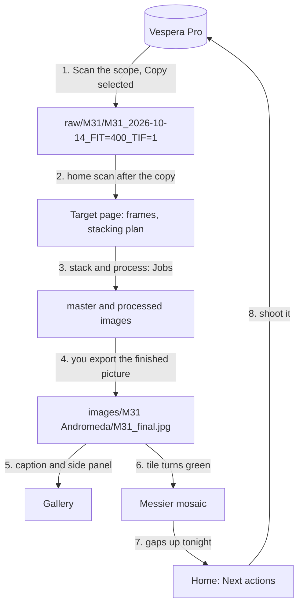

# From the scope to the mosaic

Four capabilities added in October 2026 close the loop from a night on the Vespera to a finished
picture on the wall, and back to what to shoot next. This guide shows how they fit together; each
has its own guide with the detail.

| Capability | Where it is | What it does | Guide | Spec |
|---|---|---|---|---|
| Vespera control | Data → Vespera, **Connection** card | Reaches the scope over its Wi-Fi with a read-only FTP client; sets where copies land and what kinds are copied | [Copying from the Vespera](vespera.md) | [033](../../specs/033-vespera-ftp/requirements.md) |
| Vespera ingest | Data → Vespera, **On the Vespera** card | Reviews each session from its listings, names its target, copies the ticked ones into tidy folders and indexes them | [Copying from the Vespera](vespera.md) | [034](../../specs/034-vespera-ingest/requirements.md) |
| Gallery | Gallery → Pictures | Every finished picture in `<home>/images`, captioned with the object its name names, with a side panel on that object | [The gallery](gallery.md) | [031](../../specs/031-gallery/requirements.md) |
| Messier mosaic | Targets → Messier mosaic | All 110 Messier objects with your own picture in each tile, and when each gap can be shot | [The Messier mosaic](messier-mosaic.md) | [032](../../specs/032-messier-mosaic/requirements.md) |

## The loop

1. **Copy off the scope.** On the PC, joined to the Vespera's Wi-Fi, **Scan the scope** lists every
   session without downloading anything. Each one shows what it holds and anything that looks
   wrong, and its target is read from the folder name (or the scope's metadata, or a name you
   type). **Copy selected** copies the ticked sessions, FITS and TIFF by default, each into
   `<where copies land>/<target>/<target>_<date>_FIT=<n>_TIF=<n>`.
2. **Indexed.** When the copies are in, the app runs the home scan (copies land in the home
   folder's `raw` folder unless you set **Settings → Folders → Vespera copies** elsewhere). The
   frames show on their target's page, in **Hidden in your files** and in Next actions' "ready to
   stack" suggestions.
3. **Stack and process.** The target's **Stack and process** tab plans the Siril stack and
   queues it in Jobs, as before ([Using the cockpit](cockpit.md#on-a-targets-page)).
4. **Export.** Save your finished picture under `<home>/images`, in a folder named for the object
   or with the object in its file name: `images/M31/final.jpg`, `images/M31 Andromeda/v2.png` and
   `images/M31_final.jpg` all count.
5. **Gallery.** The picture appears in Gallery → Pictures the next time it opens, captioned "M31 ·
   Andromeda Galaxy", with what the object is, when it is best placed from your site and what you
   have of it.
6. **Mosaic.** M 31's tile turns green with your picture in it (press **Refresh** if the mosaic is
   open).
7. **What next.** The mosaic says when each remaining gap is up, and Home's Next actions names the
   three best Messier gaps up tonight.

## Where files live

| Folder | Written by | Read by |
|---|---|---|
| The Vespera's `user` folder | The scope only | Vespera ingest (listings and reads; never a write) |
| `<home>/raw/<target>/<session folder>` (or the folder set as Vespera copies) | Vespera ingest: the frames, `astrorepo.transfer.json` while copying, `astrorepo.manifest.json` when done | The home scan, the stacking plan |
| `<landing folder>/astrorepo.transfers.json` | Vespera ingest | The Vespera page, to show what is already copied and to resume |
| The work area | Siril jobs | Stacking, the inspector, the mosaic (masters) |
| `<home>/images` | You | The gallery and the mosaic (never written) |

## What each one promises

- **The scope is never changed.** The FTP client can send only listing and reading commands; any
  other is refused before it reaches the network.
- **No half files.** Each file is copied into a `.part` file and takes its name only when its size
  matches the scope's listing. A dropped link pauses the copy and **Resume** carries on from the
  partial file.
- **No overwrites.** A copy never writes into a folder that holds another session or something
  astrorepo did not copy.
- **Proof of a copy.** Every finished copy has a manifest with each file's SHA-256.
- **Your pictures are read-only.** The gallery and the mosaic list and draw `<home>/images`; they
  never move, rename or write a file there.
- **One set of sky rules.** The mosaic's "up tonight", "moon too bright" and season months come
  from the same rules and settings as the Sky planner, so the two never disagree.

## Not yet checked against real hardware

These follow the scope's documentation and owners' write-ups and wait on a real listing
([#23](https://github.com/lgriffin/astrorepo/issues/23)):

- the keys inside the Vespera's observation.json and the TIFF file name with TIFF export on;
- whether the scope honours FTP's REST (without it, a resumed file starts again);
- MLSD against LIST, and EPSV against PASV, on current firmware;
- Windows shell thumbnails for TIFF tiles, and the layout of a real images folder.
