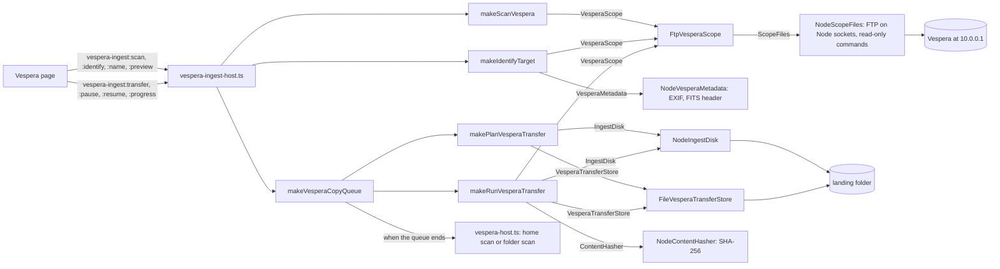

# Copying from the Vespera

The Vespera Pro keeps its observations on its own storage and serves them over its Wi-Fi. The
**Vespera** page under Files reviews what each session holds and copies the ones you tick onto the
PC, then indexes them, so they show on their targets and in the stacking plan. The scope is only
ever read. Requirements: [spec 033](../../specs/033-vespera-ftp/requirements.md) (the connection)
and [spec 034](../../specs/034-vespera-ingest/requirements.md) (the review and copy).

## Using it
The Vespera keeps its observations on its own storage and serves them over its Wi-Fi. **Files →
Vespera** looks at what each session holds before anything is copied, then copies the ones you
tick without an FTP client (specs 033 and 034, after Leigh's ingest design).

1. Join the PC to the Vespera's Wi-Fi.
2. Check the **Connection** card: the scope's address (10.0.0.1 unless you changed it), where
   copies land, and the kinds of file to copy. FITS frames and the TIFF stack are copied by
   default; tick JPEG for the scope's previews and JSON for its metadata.
3. Press **Scan the scope** on the **On the Vespera** card. Every session under `user` is listed
   newest first with its FITS, TIFF and JPEG counts and how much a copy of the chosen kinds
   takes. Only listings are read, nothing is downloaded. Auto-init and sun sessions are folded
   away; tick **Show auto-init, sun and other sessions** to see them.
4. Open a session. Its runs (`01-images-initial`, `04-images-adjust-framing` …) show their own
   counts, and its findings say what looks wrong:
   - **Error**: no image run at all, or more JPEGs than FITS (the listing was partial or files
     are missing). The session cannot be ticked.
   - **Check**: an image run with no images, no TIFF (TIFF export was off), FITS frames missing
     from the sequence, or a run whose folder name Windows would not keep (it stays on the scope).
   - **Note**: frames left out of the stack, no FITS (raw saving was off), sidecar JSON that does
     not match the JPEGs, files or runs astrorepo does not know.
5. Check the target. It comes from the folder's name (`…_observation_NGC3372` is NGC 3372); a
   name that is not a catalogue designation, such as `moon`, is marked `?`. **Check the scope's
   metadata** reads observation.json, then the last stack's EXIF, then a FITS header, and says if
   they disagree. Type a name (`M 31`, `Jellyfish Nebula`) and **Use this name** to set your own.
   The open session shows where its copy goes: `<where copies land>/M31/M31_2026-10-14_FIT=400_TIF=1`,
   the target's folder and then a folder named for the target, the date and the counts of each
   kind copied (a kind with no files, such as TIFF on a night without one, is left out).
6. Observations that can be copied and are not on the PC yet are ticked. The line under the
   table says how much the ticked sessions take and how much room is free where copies land.
   Press **Copy selected**. Sessions copy one after another; files come one at a time, FITS
   first, each into a `.part` file that takes its name only when it is as long as the scope
   listed. The progress shows the session of how many, the file, the bytes done, the speed and
   the time left. **Pause** stops after the current file, and the sessions after it wait.

Copies land in **Settings → Folders → Vespera copies**, or in the home folder's `raw` folder
when that is not set. When a copy ends, the app runs the home scan, so the frames show on their
target, in Home's Ready to process list and in the stacking plan (after any home scan already running); a
landing folder anywhere else is scanned on its own and shows under FITS files.

If the Wi-Fi drops, the copy pauses and keeps its `.part` file; open the session and press
**Resume**. It lists the session again, carries on from the first file not yet copied, and starts
the partial file from where it stopped when the scope allows it. A session that grew while
paused (it was still running) is noted; the folder keeps its name and the copy keeps to what was
planned. If the landing disk is short of room, the copy pauses before fetching anything and says
how much more is needed.

When every file of a session is in, astrorepo hashes each copy with SHA-256 and writes
`astrorepo.manifest.json` in its folder: the session, the target and why, the kinds and counts,
each file's path, size and hash, and the findings. The row then says **In the repository**.
Every copy is also listed in `astrorepo.transfers.json` at the top of the landing folder.

What the copy never does:

- change anything on the scope. It only lists and reads; the scope's own app, Singularity, is
  where observations are deleted.
- copy into a folder that holds another session. That session is skipped and the progress says
  why; **Use the next free name** copies it into `…_2`.
- leave half a file under its own name.

The Vespera's FTP layout was read from Leigh's scope's `user` listing; the keys inside
observation.json and the TIFF file name with TIFF export on have not yet been seen on a real
scope ([#23](https://github.com/lgriffin/astrorepo/issues/23)).

## How it works

The page talks to one long-lived host, `src/main/vespera-ingest-host.ts`, which keeps the last
scan, any target names you set and the one copy queue. Each step is a use case in
`packages/application/src/use-cases/vespera-ingest.ts`; every rule (what a folder name means, what
a session holds, what looks wrong, what the copy folder is called, whether there is room) is a
pure function in `packages/domain/src/vespera-ingest.ts`.

### Scan

`makeScanVespera` lists the `user` folder and each session in it, and nothing else: no file is
downloaded. The domain turns the listing into sessions (`buildSession`: when it started, what
kind it is, its runs by their suffix) and counts each run's FITS, TIFF, JPEG and JSON
(`inventorySession`), raising findings at three levels: error, check and note. An error finding
stops a session being ticked.

### Name the target

`resolveTarget` reads the folder's name first (`…_observation_NGC3372` is NGC 3372) and marks a
name that is no catalogue designation for review. **Check the scope's metadata** runs
`makeIdentifyTarget`, which reads only the first bytes of each file it needs (256 KB of
observation.json, 128 KB of the stack's EXIF, ten FITS header blocks), cheapest first, and raises
a finding when they disagree. A name you type goes through `overrideTarget` and wins.

### Plan

`makePlanVesperaTransfer` lists the files of the kinds you chose (`planTransfer`, FITS first, then
JPEG, TIFF and JSON) and names the copy folder with `destinationFolderName`:
`<target>/<Target>_<date>_FIT=<n>_TIF=<n>`, leaving out a kind with no files. When that folder
already exists it reads the record inside: the same session resumes, another session is refused
(or, with **Use the next free name**, copied into `…_2`), and a folder astrorepo did not make is
never written into. The planned job is saved twice: in `astrorepo.transfers.json` at the landing
root and as `astrorepo.transfer.json` inside the copy folder, so a copy can be found again even
after the landing folder changes in Settings.

### Copy

`makeVesperaCopyQueue` copies the ticked sessions one after another. For each,
`makeRunVesperaTransfer`:

1. On a resume, lists the session again; new or changed files are noted (`SESSION_GREW`), and the
   copy keeps to what was planned.
2. Checks the room left (`transferRoom`), counting what any `.part` file already holds, and pauses
   before reading anything when the disk is short.
3. Copies one file at a time into `<name>.part`, starting from the bytes already there when the
   scope honours FTP's REST. A file is renamed to its own name only once its size matches the
   listing; a wrong size is tried again, three times in all, before the copy pauses.
4. Records each finished file in the job, so a pause after any file loses nothing.
5. When every file is in, checks each size again, hashes each with SHA-256 and writes
   `astrorepo.manifest.json`.

A dropped link (`ScopeDisconnectedError`) pauses the job; it never fails it. **Pause** is checked
between files. When the queue ends, `vespera-host.ts` indexes the copies: a home scan when copies
land in the home folder's `raw` folder (waiting for a scan already running), otherwise a FITS
scan of the landing folder.

### Why the scope cannot be changed

The FTP client in `src/main/adapters/node-ftp-scope.ts` refuses any command outside
`READ_ONLY_COMMANDS` (USER, PASS, TYPE, EPSV, PASV, CWD, MLSD, LIST, REST, RETR and QUIT) before
it reaches the socket, and refuses a command holding a line break. There is no code path that
could delete, rename or upload. Every reply, passive address and listing the scope sends is read
by pure functions in `packages/domain/src/ftp.ts`, which the fuzz tests feed with malformed input.

### How it is tested

- Domain rules by example (`packages/domain/test/vespera-ingest.test.ts`), by property tests
  (`packages/domain/test/properties/vespera-ingest.property.test.ts`) and by mutation testing.
- Use cases against the testkit's in-memory scope and disk (`packages/application/test/vespera-ingest.test.ts`),
  including dropped links, short disks, grown sessions and duplicate folders.
- Port contracts (`packages/testkit/src/contracts/scope.contract.ts` and
  `vespera-ingest.contract.ts`) run on the fakes and on the real adapters, the FTP ones against
  `tests/helpers/ftp-server.ts`, a local FTP server that answers as the Vespera is reported to
  (MLSD and EPSV, or LIST and PASV naming an address the PC cannot reach), drops connections and
  ignores REST when told to.
